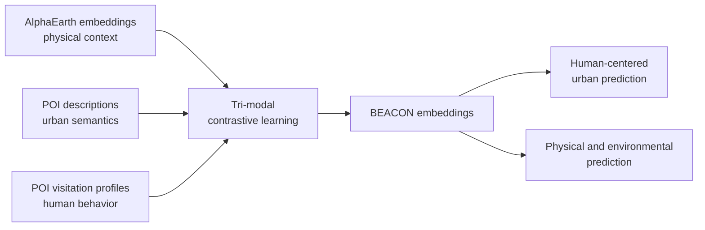

# BEACON: Behavioral and Semantic Enrichment of AlphaEarth

**Tri-modal contrastive learning for human-contextualized geospatial embeddings**

[](https://doi.org/10.1145/3841645.3843383)
[](#repository-status)
[](LICENSE)

## Overview

Geospatial foundation models such as AlphaEarth produce compact, globally consistent representations of the Earth's surface. Because they learn mainly from Earth-observation imagery, their embeddings capture physical and spectral characteristics more strongly than human activity or urban function.

BEACON addresses this limitation with a tri-modal contrastive learning framework that aligns three complementary views of urban space:

- **Physical:** multi-scale AlphaEarth embeddings
- **Semantic:** point-of-interest (POI) description embeddings
- **Behavioral:** hourly and seasonal POI visitation patterns

POI text and mobility provide supervision during training. After training, BEACON generates a 128-dimensional representation from AlphaEarth inputs alone, so deployment does not require POI or mobility data.



## Study design

The study uses the Houston-The Woodlands-Sugar Land Metropolitan Statistical Area in 2024.

- **Pretraining anchors:** 160,944 POIs with complete mobility records
- **AlphaEarth input:** 64-dimensional annual embeddings at 10 m resolution
- **Physical views:** mean-pooled 9 x 9 local and 19 x 19 context windows
- **Semantic view:** 384-dimensional embeddings of POI category, name, and NAICS descriptions
- **Behavioral view:** 184-dimensional profiles combining hour-of-week, monthly patterns, and four activity descriptors
- **Training objective:** four symmetric InfoNCE alignment terms
- **Evaluation:** seven regression and two classification tasks, using frozen linear and MLP probes over five seeds
- **Baselines:** coordinates, Space2Vec, SatCLIP, TESSERA, Clay, and AlphaEarth

## Main results

Under a frozen linear probe, BEACON improves human-centered prediction while remaining competitive on physical and environmental tasks.

| Downstream target | AlphaEarth | BEACON | Relative improvement |
|---|---:|---:|---:|
| Median household income, R² | 0.379 | **0.463** | **+22%** |
| Obesity prevalence, R² | 0.431 | **0.614** | **+43%** |
| Poor mental health, R² | 0.393 | **0.528** | **+34%** |
| Nighttime lights, R² | 0.663 | **0.680** | +3% |
| Functional land use, Macro-F1 | 0.456 | **0.471** | +3% |

BEACON remains close to AlphaEarth on land-surface temperature and PM2.5 prediction. AlphaEarth retains the strongest land-cover classification result, while BEACON ranks second. Ablations show that POI semantics and mobility behavior provide complementary supervision.

## Repository status

This repository is the public research companion for the ACM SIGSPATIAL 2026 paper. It includes the cleaned, English-language research pipeline as three notebooks. The notebooks contain no outputs, machine-specific paths, credentials, or provider-restricted data.

## Pipeline notebooks

1. [`01_data_preparation.ipynb`](notebooks/01_data_preparation.ipynb) builds the POI-level tri-modal training table and exports regional AlphaEarth tiles.
2. [`02_model_training.ipynb`](notebooks/02_model_training.ipynb) trains BEACON, evaluates cross-modal alignment, and projects AlphaEarth tiles to 128-dimensional BEACON embeddings.
3. [`03_downstream_tasks.ipynb`](notebooks/03_downstream_tasks.ipynb) aggregates embeddings to nine downstream tasks and evaluates frozen linear and MLP probes.

## Installation

```bash
python -m venv .venv
source .venv/bin/activate
pip install -r requirements.txt
```

Set the project root before running the notebooks:

```bash
export BEACON_PROJECT_DIR=/path/to/beacon-data
```

Optional data-access steps use environment variables rather than embedded credentials or account identifiers:

```bash
export MONGODB_URI=mongodb://localhost:27017/
export OPENAI_API_KEY=your_key
export OPENAI_BASE_URL=https://api.openai.com/v1       # optional
export GOOGLE_CLOUD_PROJECT=your_google_cloud_project
export BEACON_GEE_POI_ASSET=projects/PROJECT/assets/ASSET
```

External-service and cloud-export sections are disabled by default. Review the configuration cell in each notebook before enabling them.

## Planned structure

```text
.
├── configs/            experiment and dataset configuration
├── data/               data-access notes; no restricted data
├── docs/               method and reproducibility documentation
├── notebooks/          complete data, training, and evaluation pipeline
├── src/                training, inference, probes, and evaluation
├── CITATION.cff
├── LICENSE
├── requirements.txt
└── README.md
```

## Data availability

This repository will not redistribute licensed POI visitation records or other restricted source data. The `data/` directory documents expected inputs, spatial supports, and access conditions. Public downstream datasets should be downloaded from their original providers and cited according to their licenses.

Do not commit raw data, credentials, API keys, trained checkpoints, or derived files that retain provider-restricted information.

## Paper

Hao Tian, Heng Cai, and Yifan Yang. 2026. **BEACON: Behavioral and Semantic Enrichment of AlphaEarth Embeddings through Tri-Modal Contrastive Learning.** In *The 34th ACM International Conference on Advances in Geographic Information Systems (SIGSPATIAL '26)*, November 3-6, 2026, Riverside, CA, USA. ACM, New York, NY, USA, 4 pages. <https://doi.org/10.1145/3841645.3843383>

```bibtex
@inproceedings{tian2026beacon,
  title     = {BEACON: Behavioral and Semantic Enrichment of AlphaEarth Embeddings through Tri-Modal Contrastive Learning},
  author    = {Tian, Hao and Cai, Heng and Yang, Yifan},
  booktitle = {Proceedings of the 34th ACM International Conference on Advances in Geographic Information Systems},
  year      = {2026},
  doi       = {10.1145/3841645.3843383}
}
```

## License

Code in this repository is released under the [MIT License](LICENSE). The paper, figures, presentation materials, datasets, and third-party assets retain their original licenses or copyright terms unless a file states otherwise.

## Contact

Hao Tian  
Department of Geography, Texas A&M University  
<haotian@tamu.edu>
